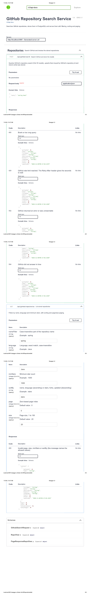

# GitHub Repository Search Service

Spring Boot service that searches GitHub repositories through the GitHub REST API, stores the results in PostgreSQL, and serves them through a paginated, filterable REST API.

## What it does
- `POST /api/github/search` queries GitHub's repository search (first 30 results), upserts them keyed by GitHub's numeric repository id, and returns what was stored.
- `GET /api/github/repositories` lists the stored repositories with name, language and minimum-stars filters, sorting, and page/size paging (size 1 to 100).
- Searching again updates existing rows (stars, forks, description) instead of duplicating them. The database enforces this with a unique constraint on `github_id`.
- GitHub failures are translated: rate limit gives 429 with a `Retry-After` header, a timeout gives 504, any other upstream error gives 502. Bad input gives 400 with a problem-detail body.

## Architecture

    Client
      |
      v
    GithubController     REST endpoints, OpenAPI annotations
      |
      v
    GithubService        validation, upsert, sort whitelist, paging
      |-- GithubClient --> GitHub REST API     timeouts, optional token, rate-limit mapping
      |-- Spring Data JPA --> PostgreSQL       schema owned by Flyway migrations

## Tech stack

| Area | Technology |
|---|---|
| Language | Java 17 |
| Framework | Spring Boot 3.5.3, Spring Web, Spring Data JPA |
| Database | PostgreSQL 16, Flyway migrations, Hibernate schema validation |
| API docs | springdoc OpenAPI, Swagger UI |
| Tests | JUnit 5, Mockito, MockMvc, MockRestServiceServer, Testcontainers |
| Containers | Docker, Docker Compose |
| CI | GitHub Actions (no deployment step) |

## Getting started
Prerequisites: Java 17, Docker Desktop with Compose, Git. The Maven wrapper is included.

    git clone https://github.com/Mohitkundu360/github-repo-search-service.git
    cd github-repo-search-service

### Option A: everything in Docker

    docker compose up -d --build

The app is on `http://localhost:8081`, PostgreSQL on host port 5434.

### Option B: app on your machine, database in Docker

    docker compose up -d postgres
    ./mvnw spring-boot:run

The app is on `http://localhost:8080`. Stop anything else that uses port 8080 first. The first start applies the Flyway migrations.

### Configuration
Values come from environment variables, with local defaults.

| Variable | Default | Purpose |
|---|---|---|
| `DB_URL` | `jdbc:postgresql://localhost:5434/githubdb` | JDBC URL |
| `DB_USERNAME` | `github` | database user |
| `DB_PASSWORD` | `github` | database password |
| `GITHUB_TOKEN` | empty | optional GitHub token, sent as a Bearer header |
| `GITHUB_API_URL` | `https://api.github.com` | GitHub API base URL |
| `POSTGRES_PASSWORD` | `github` | Compose only, copy `.env.example` to `.env` to change it |

Connect and read timeouts are `github.api.connect-timeout-ms` (3000) and `github.api.read-timeout-ms` (10000) in `application.properties`. The defaults are local development values only. Never commit real credentials or tokens.

In local testing, the 11th anonymous search within a minute got HTTP 429. A token raises GitHub's limit. The token path is covered by a unit test and was not exercised against the live API in my runs.

### Try it

    curl -X POST http://localhost:8080/api/github/search -H "Content-Type: application/json" -d '{"query":"spring boot"}'
    curl "http://localhost:8080/api/github/repositories?language=java&minStars=1000&sortBy=stars&size=5"

## API

| Operation | Method | Endpoint |
|---|---|---|
| Search GitHub and store results | POST | `/api/github/search` |
| List stored repositories | GET | `/api/github/repositories` |

Query parameters of the list endpoint:

| Parameter | Meaning |
|---|---|
| `nameFilter` | case-insensitive part of the name (`%` and `_` are matched literally) |
| `language` | exact match, case-insensitive |
| `minStars` | minimum stars, 0 or more |
| `sortBy` | `name`, `language` (ascending), `stars`, `forks`, `updated` (descending), ties broken by id |
| `page` | zero-based page index, default 0 |
| `size` | page size 1 to 100, default 20 |

The list returns an object with `content`, `page`, `size`, `totalElements` and `totalPages`.

Swagger UI: `/swagger-ui.html`. OpenAPI JSON: `/v3/api-docs`.

## Database
Flyway owns the schema: `V1` creates `github_repositories` with a unique constraint on `github_id`, `V2` adds the index `idx_repos_lang_stars` on `(lower(language), stars DESC, id)`. Hibernate runs with `ddl-auto=validate`, so the app refuses to start if the entities and the schema disagree.

### Index benchmark
Local test: 200,198 rows (synthetic, 10 languages, skewed star counts), PostgreSQL 16 in Docker, `EXPLAIN ANALYZE`, warm cache, second of two runs. Query: `language=java`, `minStars=1000`, `sortBy=stars`, 20 rows.

| Query | Without the index | With the index |
|---|---|---|
| Page (LIMIT 20) | Parallel Seq Scan + sort, 18.5 ms | Index Scan, no sort, 0.13 ms |
| Count (for `totalElements`) | Parallel Seq Scan, 22.2 ms | Bitmap Index + Heap Scan, 7.4 ms |

The page query gains the most. The count query improves about 3x and still reads every matching row. Full method and caveats: [docs/index-benchmark.md](docs/index-benchmark.md).

## Tests
Docker must be running. The database tests start their own PostgreSQL through Testcontainers, so no local database is needed.

    ./mvnw clean test

72 test cases:

| Class | Cases | What it covers |
|---|---|---|
| `GithubClientTest` | 26 | URL encoding, auth header, 429 and 403 rate limits, `Retry-After` parsing, 500, timeouts |
| `GithubServiceTest` | 20 | validation, insert versus update, de-duplication, sort mapping, paging checks |
| `GithubControllerTest` | 9 | status codes, error mapping, `Retry-After` header, parameter passing |
| `GithubRepositoryEntityRepositoryTest` | 9 | unique constraint, filters, LIKE escaping, stable paging (real PostgreSQL) |
| `IngestionFlowTest` | 3 | repeated search does not duplicate rows, 429 stores nothing (real PostgreSQL) |
| `SchemaMigrationTest` | 3 | migrations applied, index and unique constraint exist (real PostgreSQL) |
| `OpenApiDocsTest` | 2 | documented paths, summaries and error responses |

The GitHub API is never called in tests. It is mocked at the HTTP layer or the client layer.

## CI
GitHub Actions runs on pushes to `main` and `feature/**` and on pull requests: build and test everything, then build the Docker image. There is no deployment step.

## Project structure

    src/main/java/com/example/github/   controller, service, GitHub client, entity, DTOs, errors, OpenAPI config
    src/main/resources/db/migration/    Flyway migrations V1 and V2
    src/test/java/com/example/github/   unit, web, repository and integration tests
    docs/                               index benchmark notes, Swagger screenshot
    .github/workflows/ci.yml            CI
    docker-compose.yml, Dockerfile      local stack and image

## Limitations
- Each search stores only GitHub's first page (30 results). There is no paging through GitHub's results.
- The list endpoint uses offset paging. Very deep pages were not measured, and `totalElements` still costs a scan of the matching rows.
- No authentication on this API, no rate limiting of its own, and no caching.
- Search is synchronous. There is no scheduled refresh and no retry of failed GitHub calls.
- The request body has no bean validation. Checks happen in the service.
- Swagger UI and `/v3/api-docs` are open. Secure or disable them in production.
- The benchmark is synthetic data on one laptop. Not a production measurement.
- Not deployed anywhere.

## Next steps
- Page through GitHub results with a bounded number of pages
- Keyset (cursor) pagination for the list endpoint
- Scheduled refresh of stored repositories
- Retry with backoff for transient GitHub errors

## Author
Mohit Kundu, backend engineer (Java, Spring Boot).
[GitHub](https://github.com/Mohitkundu360) | [LinkedIn](https://www.linkedin.com/in/mohitkundu-backend)

## License
MIT. See [LICENSE](LICENSE).
